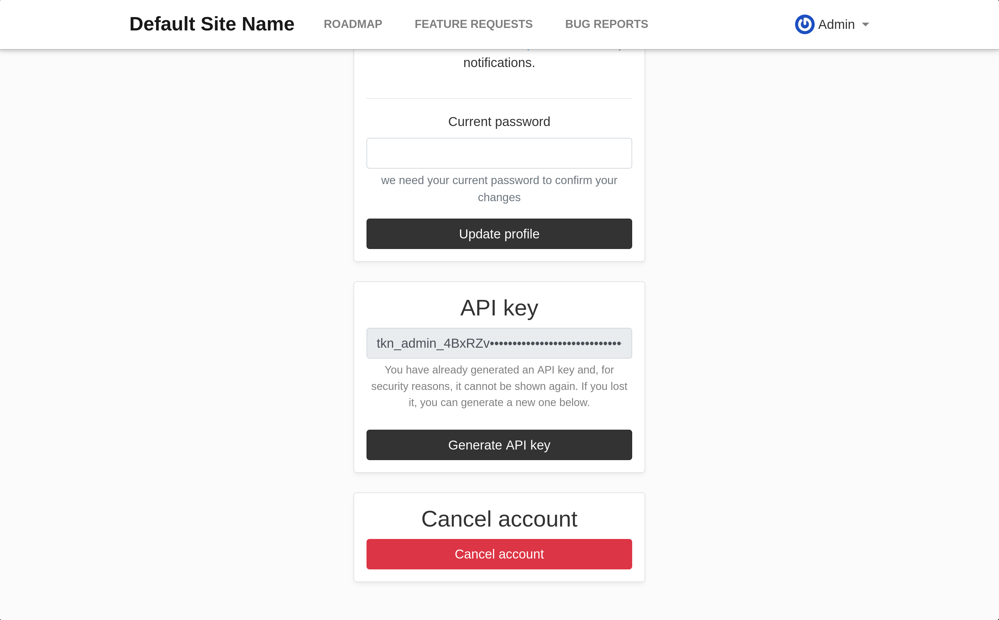

# Astuto

This guide explains how you can move your data from Astuto to [LogChimp](https://logchimp.app?ref=logchimp-docs).

If you don't have a LogChimp instance up and running, you can read
our [installation guide](https://docs.logchimp.app/self-hosting/installation) on how to install and run LogChimp
Self-Managed.

## Step 1: Create the Astuto API key

Astuto issues API keys only to administrators and moderators.

1. Log in to your Astuto site.
2. Click your name in the top-right corner, then click Profile settings.
3. In the API key section, click Generate API key.
4. Copy the key and store it as a secret.

_Astuto does not show the key again. If you lose it, generate a new one._



## Step: 2: Import your data

Now, We will be importing the data using this CLI tool.

**Usage:**

```bash
logchimp-migrate astuto
```

All arguments are optional; anything missing is prompted for.

| Option                               | Env var                                                   |
|--------------------------------------|-----------------------------------------------------------|
| `--astuto-url`                       | `ASTUTO_URL`                                              |
| `--astuto-api-key`                   | `ASTUTO_API_KEY`                                          |
| `--logchimp-url`                     | `LOGCHIMP_URL`                                            |
| `--token` / `--email` / `--password` | `LOGCHIMP_TOKEN` / `LOGCHIMP_EMAIL` / `LOGCHIMP_PASSWORD` |
| `--dry-run`, `--yes`                 |                                                           |
